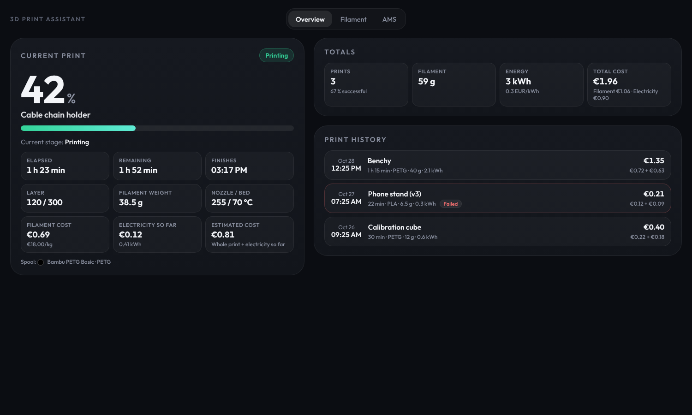

# 3D Print Assistant

[English](README.md)

> **Beta:** Dieses Projekt befindet sich im Beta-Status. Änderungen sind möglich, bitte melde Probleme als Issue.

Home-Assistant-Integration für Bambu-Lab-Drucker. Sie setzt auf
[ha-bambulab](https://github.com/greghesp/ha-bambulab) auf und liest dessen Entitäten
(Druckstatus, Gewicht, aktives Filament), statt selbst mit dem Drucker zu sprechen.

## Funktionen

- Druckhistorie (letzte 200 Drucke, persistent) mit Dauer, Ergebnis, Gewicht, Material und Farbe
- Filamentverbrauch und -kosten pro Druck und gesamt
- Stromkosten pro Druck über einen Energiezähler (kWh) oder einen Leistungssensor (W, wird über die Druckdauer integriert); Strompreis fest oder aus einer Entität
- Filamentverwaltung: Spulenbestand mit Restgewicht, Preis und Farbe, zugeordnet zu AMS-/Externe-Spule-Slots; nach jedem Druck wird das verbrauchte Filament abgezogen, bei niedrigem Bestand gibt es ein Ereignis
- Eigenes Panel „3D Print Assistant“ in der Seitenleiste mit Kennzahlen, laufendem Druck (Arbeitsschritt live, Fortschritt, Zeiten, Schicht, Gewicht, Temperaturen, Kostenschätzung, Titelbild), der Live-Kameraansicht des Druckers, geladenem Filament und Druckhistorie (aktualisiert sich live bei Druckstart und -ende)
- Ereignisse für Automationen: `druck_assistant_print_started`, `druck_assistant_print_finished`,
  `druck_assistant_print_failed`, `druck_assistant_filament_low` (mit der vorgeschlagenen Ersatzspule `replacement`), `druck_assistant_spool_insufficient` (eine Spule reicht für den laufenden Druck nicht), `druck_assistant_stock_low` (eine Sorte liegt unter ihrem Mindestbestand)

## Filamentverwaltung

Im Tab „Filament“ des Panels (Bearbeiten nur für Administratoren) legst du Spulen an, im Tab „AMS“ ordnest du
sie den Slots des Druckers zu. Der Preis der Spule ersetzt den Sortenpreis, das verbrauchte Gewicht wird am
Druckende abgezogen.

**Verbrauch:** Das Gewicht wird auf alle Spulen verteilt, die ein Druck verwendet hat. Das Add-on verfolgt den aktiven
Slot während des Drucks (Mehrfarbdruck) und nimmt die Gramm pro Slot aus dem Slicer, wenn ha-bambulab sie meldet
(Attribute des Sensors für das Druckgewicht). Läuft eine Spule leer und das AMS macht mit einer anderen Spule
desselben Filaments weiter, wird der ersten Spule nur das berechnet, was noch darauf war; der Rest geht auf die
Ersatzspule. Ohne weitere Daten entscheidet der Rest in Prozent, den das AMS pro Slot meldet. Ein nicht beendeter
Druck zählt nur mit dem erreichten Fortschritt. Jede Spule wird mit ihrem eigenen Preis belastet; die Druckhistorie
listet bei solchen Drucken die Spulen auf.

Mit „Aus AMS importieren“ werden aus den belegten AMS-Slots Spulen angelegt. Neue Bambu-Spulen mit
RFID-Tag werden zusätzlich automatisch übernommen (Option „Neue Bambu-Spulen automatisch übernehmen“);
Spulen ohne Tag, etwa Fremdfilament oder die externe Spule, werden nur über den Button importiert.
Der Restbestand wird aus der AMS-Prozentanzeige geschätzt und lässt sich von Hand korrigieren.
**Filter:** Die Karte „Spulen“ hat ein Suchfeld (Name, Material, Hersteller, Notizen, Farbe) und Filter für Material,
Hersteller und Status (Vorrat, in einem Slot, niedriger Bestand). Tabelle und Summen zeigen nur die passenden Spulen; das Popup einer Sorte listet weiterhin alle ihre Spulen.

**Spule aus dem Katalog anlegen:** Wähle in „Spule hinzufügen“ Hersteller, Filament und Farbe aus dem Katalog, um Name,
Material, Hersteller und Farbe auszufüllen; jedes Feld lässt sich danach ändern. Der Katalog enthält Bambu Lab
(`docs/bambu-filaments.md`) sowie Anycubic, Creality, Elegoo, eSUN, Flashforge, Overture, Polymaker, Prusament und Sunlu
(`docs/third-party-filaments.md`, aus der Community-Datenbank [SpoolmanDB](https://github.com/Donkie/SpoolmanDB), MIT-Lizenz;
deren Farbwerte können ungenau sein).

**Spulen bearbeiten:** Die Liste zeigt eine Zeile pro Sorte und Farbe (z. B. „Bambu PETG Basic“ in Schwarz und in Grau sind
zwei Zeilen) mit dem Gesamtbestand aller Spulen, dem Durchschnittspreis pro kg und den durchschnittlichen Kosten pro kg der aufgezeichneten Drucke („Ø gedruckt“, auch bei archivierten Spulen und bei der Spule in einem AMS-Slot). Klicke auf den Namen einer Sorte mit
mehreren Spulen, um sie einzeln aufzuklappen. Spulen bearbeitest du mit dem Button „Bearbeiten“ ihrer Zeile; das Bearbeiten-Popup
bietet auch „Löschen“. Eine Bambu-Lab-Spule in einem Slot lässt sich bearbeiten, sobald ihr RFID-Tag erkannt wurde (der Tag füllt sie aus);
Spulen auf Vorrat und Spulen anderer Hersteller, die keinen Tag haben, sind immer bearbeitbar. Eine Bambu-Lab-Spule ohne Tag,
die in einem Slot steckt, lässt sich bis zur Erkennung im AMS nur in ihrer Zeile löschen (archiviert wird automatisch, wenn eine Spule leer ist).

**Großeinkauf:** Lege das Paket mit „Spule hinzufügen“ und dem Feld „Anzahl“ an (z. B. 4 x „PETG Basic Schwarz“, Farbe Schwarz).
Wird eine neue Bambu-Spule erkannt, sucht die Integration zuerst eine passende Spule im Bestand
(nicht in einem Slot, noch ohne Tag, gleiche Sorte, ähnliche Farbe) und verwendet sie, statt eine neue
anzulegen. Der Bestand sinkt von 4 auf 3, und die eingelegte Spule wird ab dann verfolgt. Ohne Treffer wird eine neue Spule angelegt.
Passt die Zuordnung nicht, wähle in der Slot-Liste des Tabs „AMS“ die richtige Spule: Der RFID-Tag
wandert zu ihr, und die Korrektur bleibt bestehen. „keine“ stoppt die automatische Zuordnung für die
Spule, die gerade im Slot steckt (der Button „Aus AMS importieren“ hebt das wieder auf). Den RFID-Tag
einer Spule kannst du auch im Formular ändern oder leeren. Eine Bestandsspule, die ihren Tag verloren hat, bleibt einfach im Bestand.

Erreicht der Restbestand einer Spule nach einem Druck 0 g, kommt sie automatisch ins Archiv
(Option „Leere Spulen automatisch archivieren“) und löst `druck_assistant_spool_empty` aus. Spulen
stellst du in der einklappbaren Liste „Archivierte Spulen“ wieder her.
Archivierte Spulen werden nicht automatisch wieder importiert oder zugeordnet, auch wenn sie noch im AMS stecken.
Bei Drucken mit mehreren Spulen wird alles der beim Start aktiven Spule zugerechnet.

**Wiegen und Kalibrieren:** Der Waagen-Knopf einer Spule rechnet das Gewicht auf der Waage in das Restfilament um (abzüglich der
leeren Spule: 250 g bei Bambu Lab, sonst 200 g, oder dein eigener Wert). Das echte Leergewicht wird pro Spule gespeichert. Im
Formular einer Spule gibt es weitere Angaben: Kaufdatum, Händler, Bestellnummer, Charge, Lagerort und zuletzt getrocknet. Über den
Etikett-Knopf einer Zeile lässt sich ein Etikett mit Name, Sorte, Farbe, Gewicht und Ort drucken.

**Vor dem Druck:** Reicht eine Spule für das, was der Druck von ihr braucht, nicht aus, zeigt der Tab „Übersicht“ eine Warnung
und `druck_assistant_spool_insufficient` wird einmal ausgelöst. Wenn ein anderer Slot mit demselben Filament übernehmen kann,
wird er genannt. Bei einer fast leeren Spule schlägt der Tab „AMS“ (und das Ereignis für niedrigen Bestand) eine Ersatzspule aus
deinem Vorrat vor.

**Bestand und Einkaufsliste:** In den Optionen der Integration legst du pro Sorte einen Mindestbestand fest (eine Zeile pro Sorte,
z. B. `PLA=2000`). Der Tab „Filament“ zeigt dann den Bestand pro Sorte, was fehlt, die geschätzten Kosten und wie viele Tage der
Bestand bei deinem Verbrauch der letzten 30 Tage reicht, mit einem Knopf, der die Einkaufsliste kopiert. Sinkt eine Sorte unter ihr
Minimum, wird `druck_assistant_stock_low` einmal ausgelöst.

**Korrekturen, Auswertung und Listen:** Mit dem Pfeil-Knopf eines Drucks in der Historie bucht man ihn auf eine andere Spule um, das
Filament wandert mit. Der Tab „Auswertung“ zeigt Kosten, Filament, Fehlerquote und verschwendetes Geld pro Material, die Kosten pro
Monat, die teuersten Drucke und den Preis pro kg deiner Einkäufe. Spulen und Historie lassen sich als CSV exportieren, Spulen auch
aus einer CSV-Datei importieren. Der Spulenbestand wird von allen Druckern gemeinsam genutzt.

## Installation

1. ha-bambulab installieren und den Drucker einrichten.
2. `custom_components/druck_assistant` nach `config/custom_components/` kopieren (oder per HACS als Custom Repository).
3. Home Assistant neu starten, Integration „3D Print Assistant“ hinzufügen und den Drucker wählen.
4. In den Optionen Filamentpreis pro kg und Warnschwelle einstellen.

## Release

Bei jedem Push auf `main` prüft der Workflow `.github/workflows/release.yml` die Version in
`custom_components/druck_assistant/manifest.json`. Gibt es für `v<version>` noch keinen Tag,
wird er angelegt und ein GitHub Release mit `druck_assistant.zip` erstellt. Die Release Notes
stammen aus dem passenden Abschnitt `## [<version>]` der `CHANGELOG.md`, sonst werden sie
automatisch erzeugt. Zum Veröffentlichen also Version im Manifest erhöhen und den
`[Unreleased]`-Abschnitt in `## [<version>] - <Datum>` umbenennen.

## Design

Das Panel ist immer dunkel und unabhängig vom Home-Assistant-Theme. Die Optik ist an
[glow-dashboard](https://github.com/deepblue120/glow-dashboard) angelehnt (Farben, runde Karten, Tab-Leiste); der Code ist eigener.
Die Schrift ist [Outfit](https://github.com/Outfitio/Outfit-Fonts) unter der SIL Open Font License
(`custom_components/druck_assistant/frontend/fonts/OFL-Outfit.txt`). Weitere Screenshots: `docs/screenshots/`.

## Sprachen

Die Quellsprache ist Englisch. Das deutsche Sprachpaket (`translations/de.json` und das Panel) wird
automatisch anhand der Home-Assistant-Sprache gewählt.
